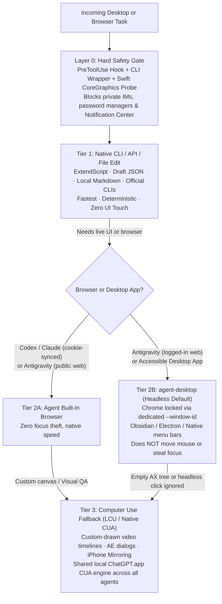

# Agent Desktop & Browser Router (`agent-desktop-router`)

**English** | **[简体中文](./README.zh-CN.md)**

> **Prefer native APIs over UI clicks, and structured trees over screenshots.**
>
> A unified three-tier macOS desktop & browser routing layer — backed by deterministic `PreToolUse` hooks, a CLI wrapper, and a native CoreGraphics window/coordinate safety guard — for **Claude Code**, **Codex**, and **Google Antigravity**.

[](#)
[](#)
[](#)
[](./LICENSE)

---

## Why `agent-desktop-router`?

Giving an AI coding agent raw Computer Use or desktop access creates three painful problems in daily work:

1. **Everything becomes a slow screenshot loop**: Agents click around UIs for tasks that could be done in 50ms via CLI, API, or local file edits.
2. **Your cursor and window focus get hijacked**: Traditional GUI automation steals focus and breaks whenever you switch browser tabs.
3. **Prompt-only safety boundaries fail**: Telling an agent *"never touch WeChat / iMessage / 1Password"* in `AGENTS.md` does not stop an unscoped `snapshot`, a stale `@ref`, or an `x,y` click from landing on a private chat window or Notification Center banner.

`agent-desktop-router` packages a battle-tested **Three-Tier Routing Workflow** together with a **zero-dependency technical safety gate** that works identically across Claude Code, Codex, and Antigravity.

---

## Quick Start

### Option A — Let Your Agent Install It (Recommended)

Paste this prompt into **Claude Code**, **Codex**, or **Google Antigravity**:

```text
Clone https://github.com/mcncarl/agent-desktop-router (or update if already cloned),
read docs/INSTALLATION.md, and configure agent-desktop-router for all agents installed
on my Mac. Run scripts/doctor.py afterward and let me know if any macOS Accessibility
permission toggle is needed.
```

### Option B — 2-Line CLI Install

```bash
git clone https://github.com/mcncarl/agent-desktop-router.git && cd agent-desktop-router
python3 scripts/install.py --agents auto && python3 scripts/doctor.py
```

*(Use `--lang zh` to inject Simplified Chinese routing rules into `AGENTS.md` / `CLAUDE.md`.)*

---

## Architecture: Safety Gate + Three-Tier Escalation



### Routing Matrix at a Glance

| Scenario | Selected Tier | Why |
| :--- | :--- | :--- |
| Project files, notes, cloud docs, timelines with scriptable APIs | **Tier 1: Native CLI / API / File** | Millisecond speed, zero UI flakiness |
| Web pages in **Codex / Claude Code** (cookie-synced), or public pages in **Antigravity** | **Tier 2A: Built-in Agent Browser** | Fastest web path when the host browser already holds (or doesn't need) cookies |
| Logged-in web pages in **Antigravity** (isolated webview) or pure CLI sessions | **Tier 2B: `agent-desktop` + dedicated `--window-id`** | Reuses your daily Chrome login state in background; tab switches in your personal window never break `@snapshot:eN` refs |
| Electron & native macOS apps (Obsidian, Finder, menu bars) | **Tier 2B: `agent-desktop` (headless)** | Reads Accessibility tree & clicks in background without moving your cursor |
| Custom-drawn canvases (CapCut/Jianying, AE modals, FocuSee, iPhone Mirroring) | **Tier 3: Computer Use (`LCU` / CUA)** | Screenshot + vision coordinates handle any pixel-rendered surface |
| Private IMs, password vaults, macOS Notification Center | **Blocked at Layer 0** | Hard-blocked before tool execution across every agent |

---

## Defense-in-Depth Safety Guard (`src/guard.py` + `src/probe.swift`)

Unlike prompt-only instructions, `agent-desktop-router` intercepts calls **before execution** across all three agent architectures:

- **Claude Code**: `PreToolUse` hook in `~/.claude/settings.json` (`Bash`, `mcp__agent-desktop__*`, `mcp__lcu__*`)
- **Google Antigravity**: Native Antigravity plugin (`~/.gemini/config/plugins/agent-desktop-router/hooks.json`)
- **Codex & Terminal**: Transparent `~/.local/bin/agent-desktop` wrapper invoking `guard.py --cli-check`

### Four Technical Enforcement Checks

1. **Config-Driven App & Compound-Term Filtering**: Blocks apps in `~/.config/agent-desktop-router/blocked-apps.json` while cleanly honoring `allowed_bundles` / `allowed_terms` exemptions (e.g., allowing enterprise work tools like **WeCom / 企业微信** and **Official Accounts / 微信公众号** while strictly blocking personal **WeChat / 微信**).
2. **No Blind Frontmost Fallback**: Rejects unscoped `agent-desktop snapshot`, `screenshot`, `find`, `press`, or `focus-window` calls that would accidentally inspect whichever private window happens to be frontmost.
3. **Live PID, Window & Coordinate Verification (`probe.swift`)**:
   - `@snapshot:eN` → resolves element PID from `refmap.json` and verifies bundle/owner via `NSRunningApplication`.
   - `--window-id w-1234` → queries `CGWindowListCopyWindowInfo` to verify the window exists and is not owned by a blocked app.
   - `--xy x,y` → inspects the full on-screen window stack at `(x, y)` so coordinate clicks cannot hit a blocked window.
4. **Anti-Bypass & Fail-Closed Design**: Blocks `agent-desktop batch`, `xargs`, `$VAR` target interpolation, and wrapper scripts; fails closed if `blocked-apps.json` is malformed.

### Default Protected Surfaces (`config/blocked-apps.default.json`)

| Category | Protected by Default | Default Exemptions (`allowed_*`) |
| :--- | :--- | :--- |
| **Private Messengers** | WeChat (`微信`, `WeChatAppEx`, Web WeChat), Apple Messages (`iMessage`), WhatsApp, Telegram, Signal | WeCom (`企业微信` / `com.tencent.WeWorkMac`), WeChat Official Accounts (`微信公众号`), WeRead (`微信读书`) |
| **Credentials & Vaults** | 1Password, Bitwarden, macOS Keychain Access (`钥匙串访问`) | — |
| **System Surfaces** | macOS Notification Center (`block_notification_center: true`) | `dock`, `menu-bar-extras` |

Customize `~/.config/agent-desktop-router/blocked-apps.json` anytime — changes apply immediately with zero agent restart.

---

## CLI Reference

```bash
# Install or update across Claude Code, Codex, and Antigravity (idempotent)
python3 scripts/install.py --agents auto [--lang en|zh] [--no-rules] [--dry-run]

# Check config, native Swift probe, CLI wrapper, Accessibility state & ChatGPT.app signature
python3 scripts/doctor.py [--json]

# Cleanly remove managed hooks, rule blocks & plugin (moves files to macOS ~/.Trash)
python3 scripts/uninstall.py [--purge-config]

# Run the automated test suite
python3 -m unittest discover -s tests -v
```

See **[docs/INSTALLATION.md](./docs/INSTALLATION.md)** for full setup details, `agent-desktop` / `amontlabs/lcu` integration notes, and permission troubleshooting.

---

## Repository Layout

```text
agent-desktop-router/
├── config/blocked-apps.default.json      # Default protected apps & safe work exemptions
├── docs/INSTALLATION.md                  # Human + Agent step-by-step installation runbook
├── scripts/
│   ├── install.py                        # Idempotent multi-agent installer
│   ├── doctor.py                         # Health, Accessibility & bundle diagnostics
│   └── uninstall.py                      # Non-destructive uninstaller (uses ~/.Trash)
├── skills/desktop-browser-routing/       # On-demand operational skill for all 3 agents
├── src/
│   ├── guard.py                          # Zero-dependency Claude / Antigravity / CLI guard
│   └── probe.swift                       # Native CoreGraphics & AppKit window/PID inspector
├── templates/                            # English & Chinese AGENTS.md snippets + plugin assets
└── tests/test_router.py                  # Automated guard, probe & lifecycle tests
```

---

## Credits & License

- Integrates with [`vercel-labs/agent-desktop`](https://github.com/vercel-labs/agent-desktop) (Tier 2) and [`amontlabs/lcu`](https://github.com/amontlabs/lcu) (Tier 3); see [THIRD_PARTY_NOTICES.md](./THIRD_PARTY_NOTICES.md).
- Licensed under the **[GNU Affero General Public License v3.0 (AGPL-3.0)](./LICENSE)**.
