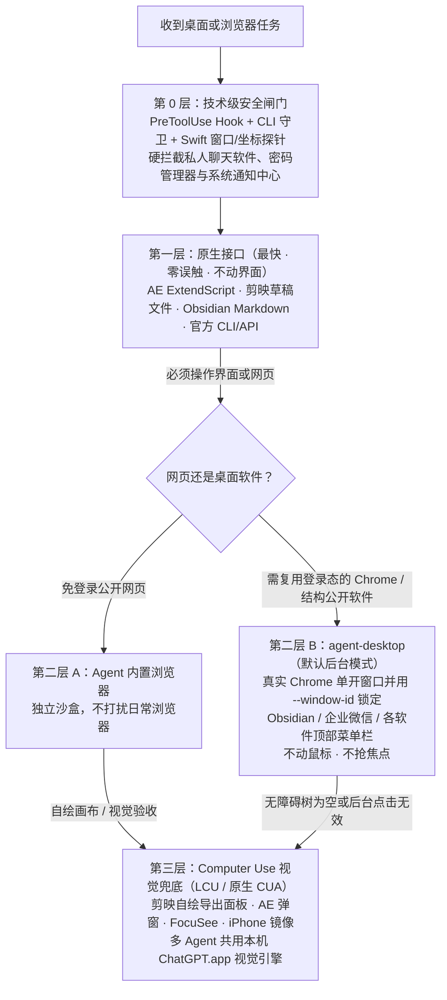

# Agent Desktop & Browser Router (`agent-desktop-router`)

**[English](./README.md)** | **简体中文**

> **能调接口不点界面，能读结构不看截图。**
>
> 一套跨 **Claude Code**、**Codex**、**Google Antigravity** 通用的 macOS 桌面软件与浏览器**三层路由方案 + 硬件级安全守卫（`PreToolUse` Hook + CLI 包装器 + Swift 窗口/坐标探针）**。

[](#)
[](#)
[](#)
[](./LICENSE)

---

## 为什么做这个项目？

给 Agent 放开电脑操作权限后，日常高频使用最容易踩三个坑：

1. **什么都靠截图硬点**：明明一行脚本或直接改文件 50ms 就能搞定，却开着 Computer Use 慢吞吞截图烧 Token。
2. **抢鼠标、抢焦点、切标签页就翻车**：普通桌面自动化一跑起来你就没法用电脑，在浏览器里随手切个标签页还会把 Agent 的元素引用冲掉。
3. **只靠 Prompt 写“禁止碰微信/密码库”防不住误触**：不带参数的 `snapshot`、过期的 `@ref` 或偏掉的 `x,y` 坐标点击，随时可能落到微信窗口或右上角系统通知横幅上。

`agent-desktop-router` 把自用打磨成熟的**三层工具分工**和**零依赖技术守卫**打成了开箱即用的标准件，一次接入，Claude Code、Codex、Antigravity 全部对齐。

---

## 快速接入

### 方式一：直接发给你的 Agent 自动安装（推荐）

把下面这段话直接发给 **Claude Code**、**Codex** 或 **Google Antigravity**：

```text
帮我 clone https://github.com/mcncarl/agent-desktop-router（如果已存在就拉取最新），
按 docs/INSTALLATION.md 为我电脑上已安装的 Agent 配置好中文版三层路由与安全守卫（--lang zh），
跑完 scripts/doctor.py 后告诉我还需要手动开哪个系统辅助功能开关。
```

### 方式二：命令行两行装完

```bash
git clone https://github.com/mcncarl/agent-desktop-router.git && cd agent-desktop-router
python3 scripts/install.py --agents auto --lang zh && python3 scripts/doctor.py
```

---

## 核心架构：零层安全闸门 + 三层按需降级



### 三层分工速查表

| 任务场景 | 命中层级 | 核心原因 |
| :--- | :--- | :--- |
| 本地笔记、工程草稿、有现成 CLI/API 的云文档与时间线 | **第一层：原生接口** | 毫秒级完成，100% 确定性，完全不动 UI |
| 查公开资料、免登录网页测试 | **第二层 A：Agent 内置浏览器** | 独立隔离，不污染个人浏览器窗口 |
| 需复用登录态的真实 Chrome（发帖后台、内部系统） | **第二层 B：`agent-desktop` + 专用 `--window-id`** | 后台静默读写；单开窗口锁定 ID，你在原窗口随便切标签页也不串台 |
| Obsidian、企业微信、Finder、各软件顶部菜单栏 | **第二层 B：`agent-desktop`（后台模式）** | 直接读无障碍结构树并后台点击，**不抢鼠标、不抢焦点** |
| 剪映自绘按钮、AE 弹窗、FocuSee、iPhone 镜像、UI 走查 | **第三层：Computer Use（`LCU` / CUA）** | 屏幕能看见就能点，通过 `LCU` 让所有 Agent 共享同一套视觉引擎 |
| 微信、iMessage、WhatsApp、Telegram、1Password、通知中心 | **第 0 层直接熔断拦截** | 工具执行前硬拒绝，不依赖大模型自觉 |

---

## 四重技术守卫（`src/guard.py` + `src/probe.swift`）

光在规则里写“绝对禁止操作微信”不够，本项目在三个宿主上同时挂载执行前拦截：

- **Claude Code**：自动注入 `~/.claude/settings.json` 的 `PreToolUse` Hook
- **Google Antigravity**：自动生成 `~/.gemini/config/plugins/agent-desktop-router` 原生插件与 `PreToolUse` 钩子
- **Codex 与终端**：在 `~/.local/bin/agent-desktop` 生成受控包装器，每次调用先过 `guard.py --cli-check`

### 四道硬校验

1. **黑名单 + 办公白名单精准剥离**：拦截 `~/.config/agent-desktop-router/blocked-apps.json` 中的应用，同时支持长词优先豁免——例如**严防死守微信客户端（含双开、小程序、网页版）**，但**精准放行企业微信（`com.tencent.WeWorkMac`）、微信公众号、微信读书**。
2. **禁止无目标盲拍最上层窗口**：凡是不带 `--app` 或 `--window-id` 的 `snapshot` / `screenshot` / `press` 一律拒绝，防止聊天窗口恰好在最前面时被误读。
3. **Swift 原生探针实时反查 PID、窗口与屏幕坐标**：
   - `@snapshot:eN`：反查快照 `refmap.json` 的进程 PID 与 Bundle ID；
   - `--window-id w-1234`：通过 `CGWindowListCopyWindowInfo` 实时校验窗口归属；
   - `--xy x,y`：穿透检查该屏幕坐标下叠放的所有可见窗口，一旦覆盖受保护应用立即拒止。
4. **防绕过与故障闭合（Fail-Closed）**：禁止把 `agent-desktop` 塞进子脚本、`batch`、`xargs` 或使用 `$VAR` 变量传参；配置文件损坏时默认拒绝放行。

### 默认保护范围（支持随时自定义）

编辑 `~/.config/agent-desktop-router/blocked-apps.json` 保存即生效，无需重启 Agent：

- **默认拦截**：微信（`WeChat` / `WeChatAppEx` / 网页版）、Apple 信息（`iMessage`）、WhatsApp、Telegram、Signal、1Password、Bitwarden、钥匙串访问（Keychain Access）、macOS 系统通知中心。
- **默认豁免**：企业微信（`WeCom`）、微信公众号（`mp.weixin.qq.com`）、微信读书（`WeRead`）。

---

## 常用命令

```bash
# 自动检测并安装/更新（幂等，不覆盖已有自定义配置）
python3 scripts/install.py --agents auto --lang zh

# 体检：检查配置文件、Swift 探针、CLI 包装器、辅助功能权限与 ChatGPT.app 签名状态
python3 scripts/doctor.py

# 干净卸载：仅移除本项目 Hook 与规则块，托管文件移入系统废纸篓 ~/.Trash
python3 scripts/uninstall.py [--purge-config]

# 运行自动化测试套件
python3 -m unittest discover -s tests -v
```

完整前置依赖（`agent-desktop` 与可选 `amontlabs/lcu`）及权限排障指南请看 **[docs/INSTALLATION.md](./docs/INSTALLATION.md)**。

---

## 致谢与开源协议

- 第二层与第三层分别衔接开源项目 [`vercel-labs/agent-desktop`](https://github.com/vercel-labs/agent-desktop) 与 [`amontlabs/lcu`](https://github.com/amontlabs/lcu)，详见 [THIRD_PARTY_NOTICES.md](./THIRD_PARTY_NOTICES.md)。
- 本项目采用 **[GNU Affero General Public License v3.0 (AGPL-3.0)](./LICENSE)** 协议开源。
